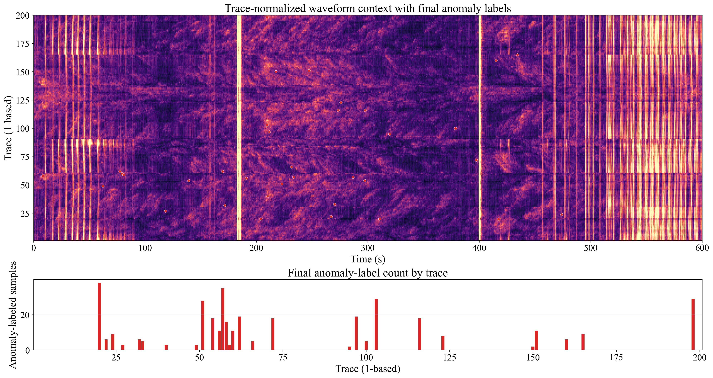
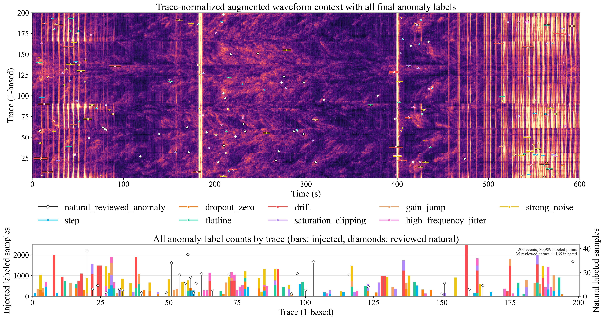

# Seismic Waveform Anomaly Benchmark

[中文说明](README_zh-CN.md) · [Dataset card](DATASET_CARD.md) · [Injection method](INJECTION_METHOD.md) · [Reproducibility](REPRODUCIBILITY.md)

This repository is a focused data release containing only the original seismic waveform dataset, final natural-anomaly labels, deterministic anomaly-injection code and configuration, the injected dataset and labels, two visualization figures, exact split indices, and documentation. Model code, checkpoints, performance tables, and model-result figures are intentionally excluded.

## Contents

```text
data/raw/seismic_200.csv                   original waveform dataset
data/natural_labels/                       two-expert final consensus labels
data/augmented/                            injected waveform, labels and event catalogs
data/splits/                               exact sample-index arrays and split manifest
injection/                                 benchmark injection and training-augmentation code
```

## Original dataset and natural labels

- Shape: 60,000 samples × 200 traces.
- Sampling rate: 100 Hz; duration: 600 s.
- Original SHA-256: `bd807a59ff60d307b2a94801ab15d9f97f7ff9d40ceceb184e6feb897998fdc7`.
- Natural anomalies: 35 final intervals and 375 labeled points.

The final natural-anomaly labels were manually reviewed by two domain experts. Candidate generation could assist inspection, but automatic candidates were not treated as ground truth. Experts used the target trace, adjacent traces, waveform morphology, and time–distance coherence; coherent physical seismic arrivals were retained as background. The public package contains the final consensus labels rather than expert identities.



## Injected benchmark

The generator uses seed `20260913` and injects step, zero dropout, flatline, drift, saturation clipping, gain jump, high-frequency jitter, and broadband strong-noise anomalies. The frozen catalog contains 165 synthetic events and preserves the paper release exactly: 80,614 synthetic labeled points, 80,989 combined labeled points, and 24,645 synthetic labeled points in the exact test split. Synthetic events are prevented from overlapping natural labels and exact buffer regions. Exact realized parameters are stored in `data/augmented/synthetic_events.csv`.

`split_ranges` in the configuration are the only train/calibration/test membership rules and exactly match the experiment program. `frozen_injection_sampling_ranges` preserves the random-number mapping of the original paper artifact; it is not an alternative split definition. The validator confirms that all 165 realized events lie wholly inside the exact experiment splits.



## Training-time augmentation

`injection/training_augmentation.py` is a model-free extraction of the augmentation actually used by the experiment program. Its corresponding parameters are frozen in `injection/training_augmentation_config.json`. The implementation preserves both stages and their original order:

1. Trace-major background augmentation: integer time shift in `[-4, 4]` samples with edge replication, amplitude scale in `[0.90, 1.10]`, zero-mean Gaussian noise with standard deviation sampled from `[0.01, 0.05]`, followed by four-pass robust cross-trace cleanup.
2. Online self-supervision on `[batch, time]` windows: base Gaussian noise with standard deviation `0.012`, then 2–7 procedurally generated events with probability `0.96`. The enabled types are pulse, burst, step, flatline, drift, dropout, jitter, clipping, gain jump, and strong noise.

This training-only configuration uses seed `20260520` and is intentionally separate from `injection/anomaly_config.json`, which controls the frozen released benchmark and uses seed `20260913`. Event decisions use Python's `random` stream; random tensors use the PyTorch stream. Both must be seeded for exact replay.

## Exact temporal splits

All intervals are zero-based and use `[start, end)` boundaries.

| Split | Exact indices | Count | Use |
|---|---:|---:|---|
| train | `0–31999` | 32,000 | training |
| buffer_1 | `32000–36095` | 4,096 | leakage guard |
| calibration | `36096–44191` | 8,096 | threshold/model selection |
| buffer_2 | `44192–48287` | 4,096 | leakage guard |
| test | `48288–59999` | 11,712 | final evaluation only |

`data/splits/split_indices.npz` contains the complete integer index array for every split. `data/splits/split_manifest.csv` provides the same boundaries in a portable table. Buffer indices contain no synthetic injection.

## Reproduce

```bash
python -m venv .venv
python -m pip install -r requirements.txt

python injection/validate_release.py \
  --config injection/anomaly_config.json \
  --results-dir data/augmented

python injection/augment_seismic_anomalies.py \
  --config injection/anomaly_config.json \
  --output-dir reproduced-augmented

# Optional: verify the extracted training augmentation (requires PyTorch)
python -m pip install -r requirements-training-augmentation.txt
python injection/training_augmentation.py \
  --config injection/training_augmentation_config.json \
  --self-test
```

Do not write regenerated files over the frozen `data/augmented/` release. See `REPRODUCIBILITY.md` for verification details.

## Label semantics

- `0`: background/no published anomaly label.
- `1`: natural data-quality anomaly in the two-expert final consensus labels.
- `2–9`: deterministic synthetic procedural ground truth.

A zero synthetic label means “not injected”; it does not prove that no unknown natural anomaly exists.
